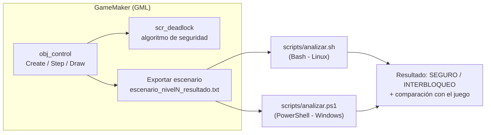

# Deadlock Dungeon: La mazmorra de los recursos

**Proyecto:** Sistemas Operativos – Universidad Manuela Beltrán (UMB)  
**Grupo:** 5  
**Estado:** Fase II – Avance funcional (videojuego en GameMaker)

### Integrantes

- Heidy Valeria Asprilla Rubiano.
- Daniela Rodriguez Reyes.

---

## 1. Descripción general

Deadlock Dungeon es un videojuego educativo 2D, desarrollado en **GameMaker (GML)** con estética pixel art, que busca enseñar de manera práctica cómo funcionan los interbloqueos (*Deadlocks*) en los sistemas operativos.

El juego tiene dos personajes principales, un caballero y un mago, que representan **procesos**. Para salir de la mazmorra necesitan **recursos compartidos**: una llave y un escudo.

Durante las partidas, el jugador cumple el papel del sistema operativo: asigna y libera recursos para que los personajes cumplan sus objetivos. Con estas situaciones se representan los bloqueos que ocurren cuando varios procesos necesitan recursos que están siendo utilizados por otros.

El proyecto combina el videojuego con scripts en **Bash** y **PowerShell** que analizan, desde el sistema operativo, los escenarios de asignación de recursos que exporta el juego.

## 2. Problemática

En los sistemas operativos, diferentes procesos pueden necesitar los mismos recursos para realizar sus actividades. Cuando estos recursos se asignan de manera inadecuada, pueden producirse interbloqueos: situaciones en las que los procesos quedan esperando recursos que no pueden obtener y ninguno logra continuar.

Este concepto puede resultar difícil de comprender cuando se estudia únicamente desde la teoría. Por eso, se propone una herramienta interactiva que represente estas situaciones mediante personajes, recursos y escenarios de juego.

## 3. Justificación

Deadlock Dungeon busca facilitar la comprensión de los interbloqueos con una experiencia en la que el usuario interactúa directamente con diferentes situaciones de asignación de recursos.

En lugar de limitarse a observar ejemplos, el jugador experimenta qué sucede cuando dos personajes necesitan recursos que están en posesión del otro, identifica cuándo se produce un bloqueo y encuentra alternativas para solucionarlo.

Además, el uso de Bash y PowerShell permite aplicar conceptos de Sistemas Operativos mediante el análisis de los escenarios simulados, relacionando la parte práctica del juego con los conocimientos vistos en clase.

## 4. Objetivos

### 4.1. Objetivo general

Desarrollar un videojuego educativo en GameMaker que permita comprender y analizar los interbloqueos en los sistemas operativos mediante la simulación de procesos, la asignación de recursos y el análisis de escenarios con scripts en Bash y PowerShell.

### 4.2. Objetivos específicos

- Diseñar una interfaz 2D interactiva en pixel art que represente los personajes, recursos y escenarios del juego.
- Implementar tres niveles que representen situaciones de asignación de recursos, interbloqueo y estado seguro.
- Implementar en GML el algoritmo de seguridad (algoritmo del banquero) para detectar interbloqueos y secuencias seguras.
- Desarrollar scripts en Bash y PowerShell que analicen los escenarios exportados por el juego y determinen si existe un bloqueo o una secuencia segura.
- Reforzar los conceptos con preguntas entre niveles y mensajes explicativos.

## 5. Alcance del producto

El prototipo se enfoca en la simulación de interbloqueos mediante un videojuego. Cuenta con dos personajes, dos recursos compartidos y tres niveles:

1. **La primera misión:** el jugador aprende cómo se asignan los recursos entre los personajes. El Caballero necesita la Llave y el Mago el Escudo.
2. **El intercambio imposible:** cada personaje empieza con un recurso y necesita el que tiene el otro, lo que genera un interbloqueo. El jugador lo identifica y se recupera **expropiando** un recurso.
3. **La salida segura:** ambos necesitan los dos recursos y no se permite expropiar. El jugador debe seguir una **secuencia segura** para que los dos terminen. Si provoca un interbloqueo, pierde el nivel.

Al terminar cada nivel aparece una **pregunta de opción múltiple** sobre el concepto practicado.

Puntuación: 100 puntos por nivel, menos 20 por cada expropiación y menos 10 por cada interbloqueo, con un mínimo de 20 por nivel. Cada pregunta acertada suma 20 (máximo 360).

El proyecto se limita a escenarios controlados dentro del juego. **No administra procesos ni recursos reales del sistema operativo.**

## 6. Usuarios o beneficiarios

El proyecto está dirigido principalmente a estudiantes que están aprendiendo conceptos de Sistemas Operativos, especialmente el funcionamiento de los procesos, los recursos compartidos y los interbloqueos.

También puede servir como herramienta de apoyo para docentes que quieran explicar estos conceptos con ejemplos visuales e interactivos.

## 7. Funcionalidades implementadas

- **Menú principal y desarrollo de niveles:** avance por tres escenarios de la mazmorra.
- **Interacción con personajes:** se ven las necesidades, los recursos y el estado (esperando, listo, terminado) del caballero y el mago.
- **Asignación de recursos:** clic en un recurso libre y luego en un personaje. Las solicitudes que superan la necesidad máxima se rechazan.
- **Liberación de recursos:** al terminar, cada proceso libera sus recursos. En el nivel 2 también se pueden expropiar.
- **Identificación de Deadlock:** detecta la espera circular y explica quién tiene qué y quién espera qué.
- **Análisis de secuencias seguras:** muestra en todo momento si el estado es seguro y cuál es la secuencia segura.
- **Visualización de resultados:** mensajes, puntuación, pantallas de victoria y derrota.
- **Preguntas entre niveles:** refuerzan los conceptos (asignación, condiciones de Coffman, estado seguro).
- **Música y efectos de sonido** originales (tecla M para la música).
- **Exportación del escenario** a un archivo de texto para analizarlo con Bash y PowerShell.

## 8. Arquitectura y estructura general

### 8.1. Arquitectura (Fase II)



- **El juego (GameMaker)** tiene toda la lógica y funciona solo.
- Cada vez que se pulsa **EJECUTAR**, el juego **exporta el escenario** a un archivo de texto en su carpeta de guardado (en Windows: `%LOCALAPPDATA%\Deadlock_Dungeon\`).
- **Los scripts Bash y PowerShell** leen ese archivo y repiten el análisis desde el sistema operativo, de forma independiente. Al final comparan su resultado con el que reportó el juego.

Detalle completo en [`documentacion/arquitectura_gamemaker.md`](documentacion/arquitectura_gamemaker.md).

### 8.2. Cambios respecto a la Fase I

| Fase I | Fase II | Motivo |
|---|---|---|
| HTML/CSS/JS | GameMaker (GML) | Indicación del profesor |
| Backend Node.js | Eliminado | GameMaker no lo necesita. La comunicación con los scripts se hace por archivo de texto |
| SQLite | Archivo de texto del escenario | GameMaker no trae SQLite nativo. Las tablas de la Fase I se conservan como modelo de datos (nivel, procesos, recursos, asignaciones, resultado) |
| Bash / PowerShell | Se mantienen | Analizan los escenarios exportados por el juego |

### 8.3. Estructura de carpetas y archivos

```text
Deadlock-Dungeon/
├── README.md
├── juego/
│   ├── codigo_gml/              Código GML del juego (copia legible)
│   │   ├── scr_deadlock.gml          Script: algoritmos de SO
│   │   ├── obj_control_Create.gml    Evento Create
│   │   ├── obj_control_Step.gml      Evento Step
│   │   └── obj_control_Draw.gml      Evento Draw
│   └── Deadlock_Dungeon/        Proyecto completo de GameMaker (.yyp)
├── scripts/
│   ├── analizar.sh              Análisis en Linux (Bash)
│   ├── analizar.ps1             Análisis en Windows (PowerShell)
│   └── escenarios/              Escenarios de ejemplo y exportados por el juego
├── documentacion/
│   ├── arquitectura_gamemaker.md
│   └── diagramas/
├── pruebas/
│   ├── registro_pruebas.md
│   ├── simulacion_logica.js     Prueba de la lógica GML fuera de GameMaker
│   ├── resultados_scripts/      Salidas reales de los scripts
│   └── capturas/                Capturas del juego funcionando
└── recursos/
    ├── imagenes/                Sprites pixel art
    ├── sonidos/                 Música y efectos de sonido
    ├── generar_sprites.py       Script que genera los sprites
    └── generar_audio.py         Script que genera la música y los sonidos
```

## 9. Modelo de datos

En la Fase I se propuso SQLite con las tablas **Niveles, Procesos, Recursos, Asignaciones y Resultados**. GameMaker no trae SQLite nativo, así que en la Fase II ese modelo se conserva en las **matrices del juego** y en el **archivo de escenario** que se exporta:

| Tabla de la Fase I | En la Fase II |
|---|---|
| Niveles | `NIVEL;n` |
| Recursos (nombre, cantidad) | `RECURSOS;Llave,Escudo` y `TOTAL;1,1` |
| Procesos (nombre, estado) + Asignaciones | `PROCESO;nombre;asignado;maximo;estado` |
| Resultados (estado) | `JUEGO;SEGURO / INTERBLOQUEO / COMPLETADO` |

Ejemplo de un archivo exportado por el juego (`escenario_nivel2_interbloqueo.txt`):

```text
NIVEL;2
RECURSOS;Llave,Escudo
TOTAL;1,1
PROCESO;Caballero;1,0;1,1;ACTIVO
PROCESO;Mago;0,1;1,1;ACTIVO
JUEGO;INTERBLOQUEO
```

## 10. Relación con los conceptos de Sistemas Operativos

| Concepto de SO | Cómo aparece en el juego |
|---|---|
| Procesos | Caballero (P0) y Mago (P1) |
| Recursos compartidos | Llave (R0) y Escudo (R1), 1 unidad de cada uno |
| Asignación de recursos | Clic en un recurso libre y después en un personaje |
| Matrices Asignado / Máximo / Necesidad | Variables `asignado`, `maximo` y `maximo - asignado` en GML |
| Vector Disponible | Panel superior derecho ("Disponibles") |
| Espera circular | Mensaje: "Caballero tiene Llave y espera Escudo (lo tiene Mago)…" |
| Interbloqueo | Estado "NO SEGURO (interbloqueo)" cuando nadie puede avanzar |
| Estado seguro y secuencia segura | Panel: "SEGURO – Secuencia segura: Caballero -> Mago" |
| Recuperación (expropiación) | Nivel 2: clic en un recurso ocupado para quitárselo a su dueño |
| Prevención / evasión | Nivel 3: no se puede expropiar; hay que asignar en un orden seguro |
| Solicitud inválida | Pedir un recurso que excede la necesidad máxima se rechaza |

## 11. Tecnologías y herramientas

| Tecnología o herramienta | Uso dentro del proyecto |
|---|---|
| GameMaker (GML) | Motor y lenguaje del videojuego: interfaz, lógica y algoritmo de seguridad |
| Bash | Analizar los escenarios en Linux (`analizar.sh`) |
| PowerShell | Analizar los escenarios en Windows (`analizar.ps1`) |
| Git Bash | Ejecutar Bash en Windows |
| Python | Generar los sprites pixel art y los sonidos (`recursos/generar_*.py`) |
| Node.js | Prueba automática de la lógica del juego fuera de GameMaker (`pruebas/simulacion_logica.js`) |
| GitHub | Alojar el repositorio y registrar los avances |

## 12. Configuración del entorno de trabajo

| Elemento | Configuración usada |
|---|---|
| Sistema operativo de desarrollo | Windows |
| Motor | GameMaker LTS 2026 (IDE v2026.0.0.16, runtime v2026.0.0.23), licencia gratuita no comercial |
| Tipo de proyecto | Blank Game, lenguaje **GML Code** (no GML Visual) |
| Plataforma de ejecución | Windows · VM (desde el IDE con ▶ Run) |
| Habitación | `rm_nivel`, 1280 × 660 px, con una instancia de `obj_control` en la capa *Instances* |
| Activos creados | Script `scr_deadlock` · Objeto `obj_control` (Create, Step, Draw) · 6 sprites `spr_*` · 6 sonidos `snd_*` |
| Archivos del juego | Sandbox de GameMaker: `%LOCALAPPDATA%\Deadlock_Dungeon\` (allí se guardan los escenarios exportados) |
| PowerShell (Windows) | Ejecución con `-ExecutionPolicy Bypass`, para no cambiar la política de seguridad del sistema |
| Bash | Git Bash (Git para Windows) o Linux / WSL |
| Control de versiones | GitHub (subida por la interfaz web, un commit por componente) |

### Requisitos de ejecución

- **Hardware:** computador de escritorio o portátil, procesador de doble núcleo o superior, 4 GB de RAM como mínimo.
- **Software:** Windows (o Linux para Bash), GameMaker, PowerShell, Git Bash, y un navegador para GitHub.

## 13. Cómo ejecutar

### El juego

1. Instalar GameMaker (gratis para uso no comercial): https://gamemaker.io/
2. Abrir `juego/Deadlock_Dungeon/Deadlock_Dungeon.yyp`.
3. Ejecutar con el botón ▶ (o F5 / Fn + F5).

**Controles:**

| Acción | Cómo |
|---|---|
| Asignar un recurso | Clic en un recurso libre y luego en un personaje |
| Expropiar un recurso (niveles 1 y 2) | Clic en un recurso ocupado |
| Ejecutar los procesos | Botón **EJECUTAR** |
| Reiniciar el nivel | Tecla **R** |
| Responder las preguntas | Clic o teclas **1 / 2 / 3** |
| Pausar o reanudar la música | Tecla **M** |

### Scripts de análisis

**Linux / Git Bash:**

```bash
cd scripts
bash analizar.sh escenarios/escenario_nivel2_interbloqueo.txt
```

**Windows (PowerShell):**

```powershell
cd scripts
powershell -ExecutionPolicy Bypass -File .\analizar.ps1 escenarios\escenario_nivel2_interbloqueo.txt
```

Para analizar un escenario generado por el juego, se pasa la ruta del archivo exportado, por ejemplo:

```powershell
powershell -ExecutionPolicy Bypass -File .\analizar.ps1 "$env:LOCALAPPDATA\Deadlock_Dungeon\escenario_nivel2_interbloqueo.txt"
```

## 14. Pruebas

Ver [`pruebas/registro_pruebas.md`](pruebas/registro_pruebas.md). Ahí se distingue lo que ya se probó de lo que falta por probar. Las capturas están en [`pruebas/capturas/`](pruebas/capturas/).

## 15. Estado actual del proyecto (Fase II)

| Componente | Estado |
|---|---|
| Lógica de detección y estado seguro (`scr_deadlock`) | ✅ Implementada. Probada fuera de GameMaker con `pruebas/simulacion_logica.js` |
| Juego en GameMaker (menú, 3 niveles, asignación, mensajes, puntos, victoria/derrota) | ✅ Implementado. Ver capturas en `pruebas/capturas/` |
| Exportación del escenario a archivo | ✅ Implementada |
| `analizar.sh` | ✅ Implementado y probado |
| `analizar.ps1` | ✅ Implementado y probado |
| Gráficos pixel art (mazmorra, caballero, mago, llave, escudo, puerta) | ✅ Implementados (`recursos/imagenes/`) |
| Música y efectos de sonido | ✅ Implementados (`recursos/sonidos/`) |
| Preguntas entre niveles | ✅ Implementadas (3 preguntas) |
| Nivel con 3 procesos y 3 recursos | 🔜 Propuesto para la siguiente fase |

### Próximos avances

- Agregar un nivel con tres procesos y tres recursos (espera circular de tres).
- Animar el movimiento de los personajes hacia la salida.
- Explorar la ejecución de los scripts desde el juego.

## Licencia

Ver [LICENSE](LICENSE).
