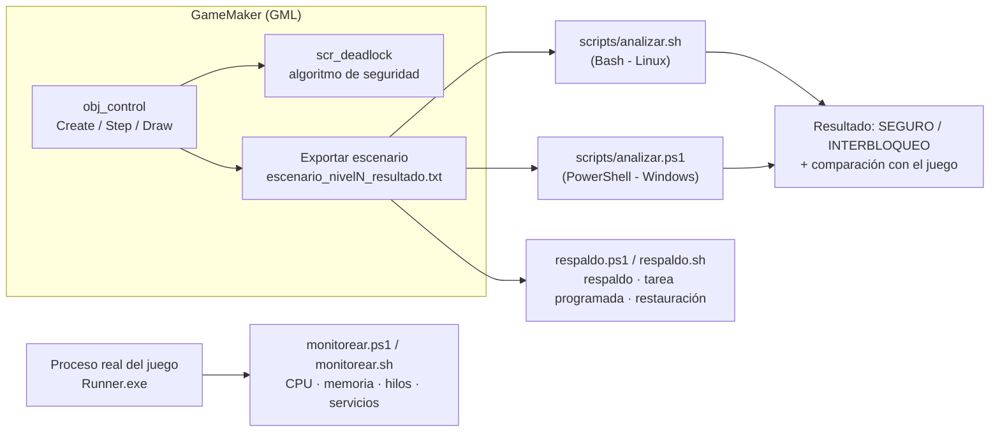

# Deadlock Dungeon: La mazmorra de los recursos

**Proyecto:** Sistemas Operativos – Universidad Manuela Beltrán (UMB)  
**Grupo:** 5  
**Estado:** Versión final (videojuego en GameMaker)

### Integrantes

- Heidy Valeria Asprilla Rubiano.
- Daniela Rodriguez Reyes.

---

## 1. Descripción general

Deadlock Dungeon es un videojuego educativo 2D, desarrollado en **GameMaker (GML)** con estética pixel art, que busca enseñar de manera práctica cómo se producen, detectan, previenen y evitan los interbloqueos (*Deadlocks*) en los sistemas operativos.

El juego tiene tres personajes, un caballero, un mago y un arquero, que representan **procesos**. Para salir de la mazmorra necesitan **recursos compartidos**: una llave, un escudo y una antorcha.

Durante las partidas, el jugador cumple el papel del sistema operativo: asigna y libera recursos para que los personajes cumplan sus objetivos. Con estas situaciones se representan los bloqueos que ocurren cuando varios procesos necesitan recursos que están siendo utilizados por otros, y las estrategias para resolverlos o evitarlos.

El proyecto combina el videojuego con scripts en **Bash** y **PowerShell** que, desde el sistema operativo, analizan los escenarios de asignación de recursos que exporta el juego, **monitorean el proceso real del juego** y **respaldan automáticamente** sus resultados.

## 2. Problemática

En los sistemas operativos, diferentes procesos pueden necesitar los mismos recursos para realizar sus actividades. Cuando estos recursos se asignan de manera inadecuada, pueden producirse interbloqueos: situaciones en las que los procesos quedan esperando recursos que no pueden obtener y ninguno logra continuar.

Este concepto puede resultar difícil de comprender cuando se estudia únicamente desde la teoría. Por eso, se propone una herramienta interactiva que represente estas situaciones mediante personajes, recursos y escenarios de juego.

## 3. Justificación

Deadlock Dungeon busca facilitar la comprensión de los interbloqueos con una experiencia en la que el usuario interactúa directamente con diferentes situaciones de asignación de recursos.

En lugar de limitarse a observar ejemplos, el jugador experimenta qué sucede cuando los personajes necesitan recursos que están en posesión de otros, identifica cuándo se produce un bloqueo y aplica las estrategias que estudia la teoría: **detección y recuperación, prevención y evitación**.

Además, el uso de Bash y PowerShell permite aplicar conceptos de Sistemas Operativos mediante el análisis de los escenarios simulados, el monitoreo de procesos y la automatización de respaldos, relacionando la parte práctica del juego con los conocimientos vistos en clase.

## 4. Objetivos

### 4.1. Objetivo general

Desarrollar un videojuego educativo en GameMaker que permita comprender y analizar los interbloqueos en los sistemas operativos mediante la simulación de procesos, la asignación de recursos y el análisis de escenarios con scripts en Bash y PowerShell, complementado con el monitoreo y el respaldo automático del entorno.

### 4.2. Objetivos específicos

- Diseñar una interfaz 2D interactiva en pixel art que represente los personajes, recursos y escenarios del juego.
- Implementar cuatro niveles que representen la asignación de recursos y las estrategias de detección y recuperación, prevención y evitación del interbloqueo.
- Implementar en GML el algoritmo de seguridad (algoritmo del banquero) para detectar interbloqueos y secuencias seguras con dos y tres procesos.
- Desarrollar scripts en Bash y PowerShell que analicen los escenarios exportados por el juego y determinen si existe un bloqueo o una secuencia segura.
- Monitorear el proceso real del juego (CPU, memoria e hilos) y automatizar el respaldo de sus escenarios con recuperación ante fallos.
- Reforzar los conceptos con preguntas entre niveles y mensajes explicativos.

## 5. Alcance del producto

El producto final se enfoca en la simulación de interbloqueos mediante un videojuego. Cuenta con tres personajes, tres recursos compartidos y cuatro niveles, **cada uno con una estrategia distinta**:

1. **La primera misión – Asignación:** el jugador aprende cómo se asignan los recursos. El Caballero necesita la Llave y el Mago el Escudo.
2. **El intercambio imposible – Detección y recuperación:** cada personaje empieza con un recurso y necesita el que tiene el otro, lo que genera un interbloqueo. El jugador lo identifica y se recupera **expropiando** un recurso.
3. **La salida segura – Prevención (regla del orden):** los recursos se deben pedir en orden, primero la Llave y después el Escudo. Si se intenta dar el Escudo a quien no tiene la Llave, la solicitud se rechaza. Así se rompe la **espera circular** y el interbloqueo no puede ocurrir.
4. **El círculo de tres – Evitación (algoritmo del banquero):** tres procesos (Caballero, Mago y Arquero) y tres recursos (Llave, Escudo y Antorcha). Solo queda la Antorcha libre y no se puede expropiar. Si se la dan al Arquero, se forma una **espera circular de tres procesos** y se pierde. La única salida es la **secuencia segura Mago → Caballero → Arquero**.

Al terminar cada nivel aparece una **pregunta de opción múltiple** sobre el concepto practicado. Cuando un proceso termina, el personaje **camina hacia la salida**.

Puntuación: 100 puntos por nivel, menos 20 por cada expropiación y menos 10 por cada interbloqueo, con un mínimo de 20 por nivel. Cada pregunta acertada suma 20 (máximo **480**).

El proyecto se limita a escenarios controlados dentro del juego. **Los procesos y recursos del juego son simulados; no administra procesos ni recursos reales del sistema operativo.**

## 6. Usuarios o beneficiarios

El proyecto está dirigido principalmente a estudiantes que están aprendiendo conceptos de Sistemas Operativos, especialmente el funcionamiento de los procesos, los recursos compartidos y los interbloqueos.

También puede servir como herramienta de apoyo para docentes que quieran explicar estos conceptos con ejemplos visuales e interactivos.

## 7. Funcionalidades implementadas

- **Menú principal y desarrollo de niveles:** avance por cuatro escenarios de la mazmorra.
- **Interacción con personajes:** se ven las necesidades, los recursos y el estado (esperando, listo, terminado) de cada proceso.
- **Asignación de recursos:** clic en un recurso libre y luego en un personaje. Las solicitudes que superan la necesidad máxima se rechazan.
- **Liberación de recursos:** al terminar, cada proceso libera sus recursos. En el nivel 2 también se pueden expropiar.
- **Identificación de Deadlock:** detecta la espera circular con dos y con tres procesos, y explica quién tiene qué y quién espera qué.
- **Análisis de secuencias seguras:** muestra en todo momento si el estado es seguro y cuál es la secuencia segura.
- **Prevención por orden de recursos:** en el nivel 3 se rechazan las solicitudes que no respetan el orden.
- **Animación:** los procesos que terminan caminan hacia la puerta y salen de la mazmorra.
- **Visualización de resultados:** mensajes, puntuación, pantallas de victoria y derrota.
- **Preguntas entre niveles:** refuerzan los conceptos (asignación, condiciones de Coffman, prevención y algoritmo del banquero).
- **Música y efectos de sonido** originales (tecla M para la música).
- **Exportación del escenario** a un archivo de texto para analizarlo con Bash y PowerShell.
- **Monitoreo del proceso del juego** (CPU, memoria, hilos y servicios) con `monitorear.ps1` / `monitorear.sh`.
- **Respaldo automático** de los escenarios, con tarea programada y restauración, con `respaldo.ps1` / `respaldo.sh`.

## 8. Arquitectura y estructura general

### 8.1. Arquitectura (versión final)



- **El juego (GameMaker)** tiene toda la lógica y funciona solo, sin conexión a internet.
- Cada vez que se pulsa **EJECUTAR**, el juego **exporta el escenario** a un archivo de texto en su carpeta de guardado (en Windows: `%LOCALAPPDATA%\Deadlock_Dungeon\`).
- **Los scripts Bash y PowerShell** leen ese archivo y repiten el análisis desde el sistema operativo, de forma independiente. Al final comparan su resultado con el que reportó el juego.
- **El monitoreo** mide el proceso real del juego (`Runner.exe` cuando se ejecuta desde GameMaker) y **el respaldo** guarda los escenarios en `C:\DeadlockDungeon\respaldos` con una tarea programada diaria.

Detalle completo en el [documento técnico final](documentacion/Documento_Tecnico_Final_G5.pdf) y en [`documentacion/arquitectura_gamemaker.md`](documentacion/arquitectura_gamemaker.md).

### 8.2. Cambios a lo largo del proyecto

| Fase I | Versión final | Motivo |
|---|---|---|
| HTML/CSS/JS | GameMaker (GML) | Indicación del profesor |
| Backend Node.js | Eliminado | GameMaker no lo necesita. La comunicación con los scripts se hace por archivo de texto |
| SQLite | Archivo de texto del escenario | GameMaker no trae SQLite nativo. Las tablas de la Fase I se conservan como modelo de datos (nivel, procesos, recursos, asignaciones, resultado) |
| 3 niveles, 2 procesos y 2 recursos | 4 niveles, hasta 3 procesos y 3 recursos | Cubrir las estrategias de detección, prevención y evitación |
| Nivel 3 de "secuencia segura" | Nivel 3 de prevención por orden de recursos | Diferenciarlo del nivel 2 y del nivel 4 |
| Bash / PowerShell para análisis | Se mantienen y se agregan monitoreo y respaldo | Conectar el juego con la administración del sistema operativo |

### 8.3. Estructura de carpetas y archivos

```text
Deadlock-Dungeon/
├── README.md
├── juego/
│   ├── codigo_gml/                   Código GML del juego (copia legible)
│   │   ├── scr_deadlock.gml               Script: algoritmos de SO
│   │   ├── obj_control_Create.gml         Evento Create
│   │   ├── obj_control_Step.gml           Evento Step
│   │   └── obj_control_Draw.gml           Evento Draw
│   └── Deadlock_Dungeon/             Proyecto completo de GameMaker (.yyp)
├── scripts/
│   ├── analizar.sh                   Análisis en Linux (Bash)
│   ├── analizar.ps1                  Análisis en Windows (PowerShell)
│   ├── escenarios/                   Escenarios de ejemplo y exportados por el juego (niveles 1 a 4)
│   └── entorno/
│       ├── LEEME.md
│       ├── windows/                  monitorear.ps1 · respaldo.ps1
│       └── linux/                    monitorear.sh · respaldo.sh
├── documentacion/
│   ├── Documento_Tecnico_Final_G5.pdf     Documento técnico final
│   ├── Documentacion_Fase_II_G5.pdf
│   ├── arquitectura_gamemaker.md
│   ├── componentes_fase2.md
│   └── diagramas/
├── pruebas/
│   ├── registro_pruebas.md           Registro de pruebas y errores
│   ├── simulacion_logica.js          Prueba de la lógica GML fuera de GameMaker
│   ├── resultados_scripts/           Salidas reales de los scripts de análisis
│   ├── resultados_entorno_linux/     Salidas del monitoreo y el respaldo en Linux
│   └── capturas/                     Capturas del juego, los scripts y el entorno
└── recursos/
    └── imagenes/                     Recursos gráficos y de audio
        ├── imagenes/                 Sprites pixel art (8)
        ├── sonidos/                  Música y efectos de sonido (6)
        ├── generar_sprites.py        Script que genera los sprites
        ├── generar_sprites_nivel4.py Script que genera el Arquero y la Antorcha
        └── generar_audio.py          Script que genera la música y los sonidos
```

## 9. Modelo de datos

En la Fase I se propuso SQLite con las tablas **Niveles, Procesos, Recursos, Asignaciones y Resultados**. GameMaker no trae SQLite nativo, así que ese modelo se conserva en las **matrices del juego** y en el **archivo de escenario** que se exporta:

| Tabla de la Fase I | En la versión final |
|---|---|
| Niveles | `NIVEL;n` |
| Recursos (nombre, cantidad) | `RECURSOS;Llave,Escudo,Antorcha` y `TOTAL;1,1,1` |
| Procesos (nombre, estado) + Asignaciones | `PROCESO;nombre;asignado;maximo;estado` |
| Resultados (estado) | `JUEGO;SEGURO / INTERBLOQUEO / COMPLETADO` |

Ejemplo de un archivo exportado por el juego en el nivel 4 (`escenario_nivel4_interbloqueo.txt`):

```text
NIVEL;4
RECURSOS;Llave,Escudo,Antorcha
TOTAL;1,1,1
PROCESO;Caballero;1,0,0;1,1,0;ACTIVO
PROCESO;Mago;0,1,0;0,1,1;ACTIVO
PROCESO;Arquero;0,0,1;1,0,1;ACTIVO
JUEGO;INTERBLOQUEO
```

## 10. Relación con los conceptos de Sistemas Operativos

| Concepto de SO | Cómo aparece en el proyecto |
|---|---|
| Procesos | Caballero (P0), Mago (P1) y Arquero (P2) · y el proceso real `Runner.exe` |
| Recursos compartidos | Llave (R0), Escudo (R1) y Antorcha (R2), 1 unidad de cada uno |
| Asignación de recursos | Clic en un recurso libre y después en un personaje |
| Matrices Asignado / Máximo / Necesidad | Variables `asignado`, `maximo` y `maximo - asignado` en GML |
| Vector Disponible | Panel superior derecho ("Disponibles") |
| Exclusión mutua | Un recurso solo puede tenerlo un proceso a la vez |
| Espera circular | Mensaje: "Caballero tiene Llave y espera Escudo (lo tiene Mago)…" (con 2 y con 3 procesos) |
| Interbloqueo | Estado "NO SEGURO (interbloqueo)" cuando nadie puede avanzar |
| Estado seguro y secuencia segura | Panel: "SEGURO – Secuencia segura: Mago -> Caballero -> Arquero" |
| Detección y recuperación | Nivel 2: se detecta el bloqueo y se expropia un recurso |
| Prevención | Nivel 3: orden total de recursos (primero la Llave, después el Escudo) |
| Evitación (algoritmo del banquero) | Nivel 4: solo se asigna si el estado sigue siendo seguro |
| Solicitud inválida | Pedir un recurso que excede la necesidad máxima se rechaza |
| Monitoreo de procesos | `monitorear.ps1` / `monitorear.sh`: CPU, memoria, hilos y prioridad del proceso del juego |
| Almacenamiento y recuperación | `respaldo.ps1` / `respaldo.sh`: respaldo, rotación y restauración |
| Automatización | Programador de tareas de Windows / cron en Linux |

## 11. Tecnologías y herramientas

| Tecnología o herramienta | Uso dentro del proyecto |
|---|---|
| GameMaker (GML) | Motor y lenguaje del videojuego: interfaz, lógica y algoritmo de seguridad |
| Bash | Analizar, monitorear y respaldar en Linux (`analizar.sh`, `monitorear.sh`, `respaldo.sh`) |
| PowerShell | Analizar, monitorear y respaldar en Windows (`analizar.ps1`, `monitorear.ps1`, `respaldo.ps1`) |
| Programador de tareas / cron | Respaldo automático diario |
| Git Bash | Ejecutar Bash en Windows |
| Python | Generar los sprites pixel art y los sonidos (`recursos/imagenes/generar_*.py`) |
| Node.js | Prueba automática de la lógica del juego fuera de GameMaker (`pruebas/simulacion_logica.js`) |
| GitHub | Alojar el repositorio y registrar los avances |

## 12. Configuración del entorno de trabajo

| Elemento | Configuración usada |
|---|---|
| Sistema operativo de desarrollo | Windows 11 Pro |
| Equipo de pruebas | Intel Core i3-10110U (4 núcleos lógicos), 11,8 GB de RAM |
| Motor | GameMaker LTS 2026 (IDE v2026.1.0.27, runtime v2026.1.0.28), licencia gratuita no comercial |
| Tipo de proyecto | Blank Game, lenguaje **GML Code** (no GML Visual) |
| Plataforma de ejecución | Windows · VM (desde el IDE con ▶ Run, proceso `Runner.exe`) |
| Habitación | `rm_nivel`, 1280 × 660 px, con una instancia de `obj_control` en la capa *Instances* |
| Activos creados | Script `scr_deadlock` · Objeto `obj_control` (Create, Step, Draw) · 8 sprites `spr_*` · 6 sonidos `snd_*` |
| Archivos del juego | Sandbox de GameMaker: `%LOCALAPPDATA%\Deadlock_Dungeon\` (allí se guardan los escenarios exportados) |
| Respaldos y registros | `C:\DeadlockDungeon\` (respaldos, escenarios, logs) |
| PowerShell (Windows) | Windows PowerShell 5.1, ejecución con `-ExecutionPolicy Bypass` para no cambiar la política de seguridad del sistema |
| Bash | Git Bash (Git para Windows) o Linux (probado en Ubuntu 24.04 LTS) |
| Control de versiones | GitHub (subida por la interfaz web, un commit por componente) |

### Requisitos de ejecución

- **Hardware:** computador de escritorio o portátil, procesador de doble núcleo o superior, 4 GB de RAM como mínimo.
- **Software:** Windows (o Linux para Bash), GameMaker, PowerShell, Git Bash, y un navegador para GitHub.
- Ningún script requiere permisos de administrador.

## 13. Cómo ejecutar

### El juego

**Opción rápida (sin instalar GameMaker):** descargar `Deadlock_Dungeon_v1.0.zip` desde la sección [Releases](https://github.com/hyeaspri/DeadlockDungeon_SistemasOperativos_G5/releases), descomprimir y abrir `Deadlock_Dungeon.exe`.

**Desde el código fuente:**

1. Instalar GameMaker (gratis para uso no comercial): https://gamemaker.io/
2. Abrir `juego/Deadlock_Dungeon/Deadlock_Dungeon.yyp`.
3. Ejecutar con el botón ▶ (o F5 / Fn + F5).

**Controles:**

| Acción | Cómo |
|---|---|
| Asignar un recurso | Clic en un recurso libre y luego en un personaje |
| Expropiar un recurso (niveles 1 y 2) | Clic en un recurso ocupado |
| Ejecutar los procesos | Botón **EJECUTAR** |
| Reiniciar el nivel | Tecla **R** |
| Responder las preguntas | Clic o teclas **1 / 2 / 3** |
| Pausar o reanudar la música | Tecla **M** |

### Scripts de análisis

**Linux / Git Bash:**

```bash
cd scripts
bash analizar.sh escenarios/escenario_nivel4_inicio.txt
```

**Windows (PowerShell):**

```powershell
cd scripts
powershell -ExecutionPolicy Bypass -File .\analizar.ps1 escenarios\escenario_nivel4_interbloqueo.txt
```

Para analizar un escenario generado por el juego, se pasa la ruta del archivo exportado, por ejemplo:

```powershell
powershell -ExecutionPolicy Bypass -File .\analizar.ps1 "$env:LOCALAPPDATA\Deadlock_Dungeon\escenario_nivel2_interbloqueo.txt"
```

### Monitoreo del juego (con el juego abierto)

```powershell
cd scripts\entorno\windows
powershell -ExecutionPolicy Bypass -File .\monitorear.ps1
```

En Linux: `bash scripts/entorno/linux/monitorear.sh`

### Respaldo, tarea programada y restauración

```powershell
cd scripts\entorno\windows
powershell -ExecutionPolicy Bypass -File .\respaldo.ps1 -ProgramarTarea
powershell -ExecutionPolicy Bypass -File .\respaldo.ps1 -Restaurar "C:\DeadlockDungeon\respaldos\respaldo_AAAAMMDD_HHMMSS.zip"
```

En Linux: `bash respaldo.sh`, `bash respaldo.sh --restaurar ARCHIVO` y `bash respaldo.sh --programar`.

## 14. Pruebas y resultados

Ver [`pruebas/registro_pruebas.md`](pruebas/registro_pruebas.md). Las capturas están en [`pruebas/capturas/`](pruebas/capturas/).

| Prueba | Resultado |
|---|---|
| Lógica del juego (simulación de los 4 niveles, regla de orden y preguntas) | Correcta |
| Juego en GameMaker (4 niveles, interbloqueo de 2 y 3 procesos, preguntas, victoria con 460 / 480 y 4 / 4 preguntas) | Correcto |
| `analizar.ps1` (PowerShell 5.1) y `analizar.sh` (Git Bash y Ubuntu) con escenarios de 2 y 3 procesos | "Coinciden: SI" con el juego |
| Monitoreo de `Runner.exe` | CPU ≈ 18 %, memoria 123,5 MB, 10 hilos, prioridad High |
| Respaldo y tarea programada | 10 escenarios respaldados y verificados; tarea diaria a las 8:00 p. m. |
| Recuperación ante fallos (Windows y Linux) | Escenario eliminado recuperado desde el respaldo |

## 15. Estado actual del proyecto (versión final)

| Componente | Estado |
|---|---|
| Lógica de detección y estado seguro (`scr_deadlock`) | Implementada y probada (2 y 3 procesos) |
| Juego en GameMaker (menú, 4 niveles, asignación, mensajes, puntos, victoria/derrota) | Implementado. Ver capturas en `pruebas/capturas/` |
| Nivel 3 de prevención (regla del orden) | Implementado |
| Nivel 4 con 3 procesos y 3 recursos (algoritmo del banquero) | Implementado |
| Animación de los personajes hacia la salida | Implementada |
| Exportación del escenario a archivo | Implementada |
| `analizar.sh` / `analizar.ps1` | Implementados y probados |
| `monitorear.ps1` / `monitorear.sh` | Implementados y probados |
| `respaldo.ps1` / `respaldo.sh` (tarea programada y restauración) | Implementados y probados |
| Gráficos pixel art (mazmorra, caballero, mago, arquero, llave, escudo, antorcha, puerta) | Implementados (`recursos/imagenes/imagenes/`) |
| Música y efectos de sonido | Implementados (`recursos/imagenes/sonidos/`) |
| Preguntas entre niveles | Implementadas (4 preguntas) |
| Documento técnico final | [`documentacion/Documento_Tecnico_Final_G5.pdf`](documentacion/Documento_Tecnico_Final_G5.pdf) |

### Trabajo futuro

- Ejecutar los scripts de análisis desde el propio juego (en GameMaker requiere extensiones externas).
- Agregar recursos con varias unidades (por ejemplo, 2 llaves) para ampliar el algoritmo del banquero.
