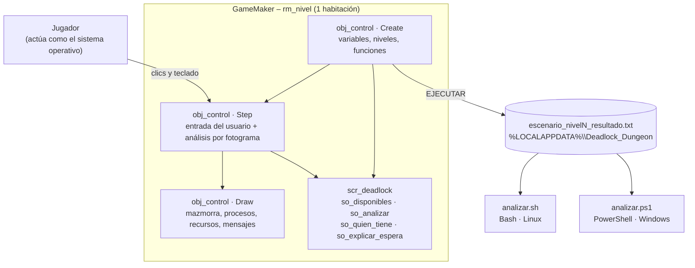
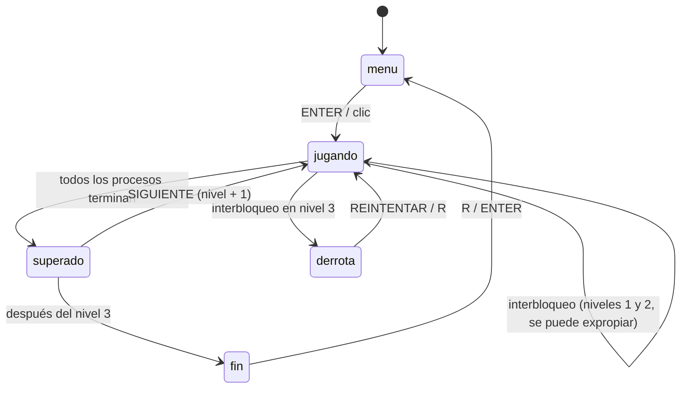

# Arquitectura de Deadlock Dungeon (versión GameMaker) – Fase II

## 1. Visión general



## 2. Componentes

| Componente | Tipo en GameMaker | Responsabilidad |
|---|---|---|
| `obj_control` | Objeto (eventos Create, Step, Draw) | Controla todo el juego: estados (menú, jugando, superado, derrota, fin), niveles, asignación y dibujo |
| `scr_deadlock` | Script | Algoritmos de SO: vector Disponible, algoritmo de seguridad, explicación de la espera circular |
| `rm_nivel` | Habitación (1280×660) | Contiene la instancia de `obj_control` |
| `analizar.sh` | Script Bash | Lee el escenario y ejecuta el mismo análisis en Linux |
| `analizar.ps1` | Script PowerShell | Lee el escenario y ejecuta el mismo análisis en Windows |

Se usa un **solo objeto controlador** en vez de un objeto por personaje para que el proyecto sea sencillo de construir y mantener. El Caballero, el Mago, la Llave y el Escudo se representan como datos (matrices) y se dibujan desde `obj_control`.

## 3. Modelo de datos

Matrices del algoritmo del banquero (procesos × recursos):

```
            Llave  Escudo
asignado  P0 [ 1     0 ]      maximo  P0 [ 1  1 ]     necesidad = maximo - asignado
          P1 [ 0     1 ]              P1 [ 1  1 ]
total      = [ 1, 1 ]
disponible = total - suma(asignado)
```

Equivalencia con las tablas SQLite de la Fase I (se conservan como modelo de datos y pasan al archivo de texto):

| Tabla Fase I | En el archivo exportado |
|---|---|
| Niveles | `NIVEL;n` |
| Recursos (nombre, cantidad) | `RECURSOS;Llave,Escudo` y `TOTAL;1,1` |
| Procesos (nombre, estado) + Asignaciones | `PROCESO;nombre;asignado;maximo;estado` |
| Resultados (estado) | `JUEGO;SEGURO / INTERBLOQUEO / COMPLETADO` |

## 4. Algoritmo de seguridad / detección (`so_analizar`)

1. `Trabajo = Disponible`, `Fin[p] = terminado[p]`.
2. Buscar un proceso `p` con `Fin[p] = falso` y `Necesidad[p] <= Trabajo`.
3. Si existe: `Trabajo += Asignado[p]`, `Fin[p] = verdadero` y se agrega `p` a la secuencia segura. Volver al paso 2.
4. Si no existe: los procesos con `Fin = falso` están en **interbloqueo**. Si todos terminaron, el estado es **seguro** y la secuencia encontrada es una **secuencia segura**.

Los mismos pasos están implementados en GML, Bash y PowerShell.

## 5. Comunicación juego ↔ scripts

GameMaker no ejecuta Bash ni PowerShell de forma nativa (necesitaría extensiones de terceros). Por eso se eligió un mecanismo simple y verificable: **un archivo de texto**.

- El juego escribe el archivo en su área de guardado (sandbox de GameMaker). En Windows es `%LOCALAPPDATA%\Deadlock_Dungeon\`, y la ruta exacta aparece en pantalla y en la ventana Output.
- El usuario ejecuta el script pasándole ese archivo.
- El script imprime su análisis y lo compara con el resultado que reportó el juego.

**Ventajas:** no depende de extensiones, funciona en Linux y Windows y cada parte se puede probar por separado.
**Limitación:** el script se ejecuta manualmente, no desde un botón del juego.

## 6. Estados del juego


